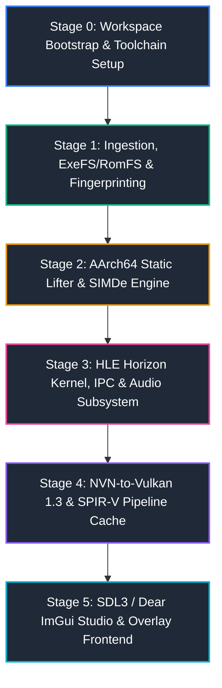

# TotK-Recomp Engineering Stages & Execution Roadmap

This roadmap breaks down the engineering execution of **`TotK-Recomp`** into 6 rigorous stages with strict verification gates, ensuring bit-exact correctness, zero regression, and reproducible builds across Linux and Windows x86_64 environments.

---

## Stage 0: Workspace Bootstrap & Toolchain Infrastructure

### 1. Objectives
- Establish a clean, legal, dual-platform repository structure.
- Enforce strict `.gitignore` guardrails preventing accidental inclusion of copyrighted Nintendo assets, binaries, keys, or shaders.
- Clone and isolate reference repositories (`totk-mobile`, `LASRecomp`, `gpu_reference`).
- Scaffold CMake 3.25+ and Zig 0.13+ parallel compilation infrastructure.
- Provide Python 3.12+ dependency scripts and initial stub libraries.

### 2. Key Deliverables
- Dual build system support: `CMakeLists.txt` for standard Clang/MSVC/GCC development; `build.zig` for parallel C recompilation.
- Vendor third-party headers and submodules (`volk`, `vulkan-headers`, `VMA`, `SDL3`, `imgui`, `simde`, `capstone`).
- Architectural and stage documentation in `docs/`.

### 3. Verification Gate (Gate 0)
- [x] Repository passes `.gitignore` audit (no `.nsp`, `.nso`, `.keys`, or `work/` tracked).
- [x] Reference repositories cloned to `reference_repos/` with depths intact.
- [x] CMake configuration completes without errors on both Linux and Windows.

---

## Stage 1: ROM Ingestion, ExeFS Demuxing & Version Fingerprinting

### 1. Objectives
- Implement automated extraction and demuxing of user-supplied Nintendo Switch containers (`.nsp`, `.xci`).
- Decrypt (using user-provided `prod.keys` and `title.keys` stored exclusively in `local/`) and decompress NSO segments (`.text`, `.rodata`, `.data`, `.bss`).
- Validate module hashes strictly against Tears of the Kingdom v1.4.3:
  - `main`: `e84a90d551fed0824b4b74933b9c6d043c458521363a7cea58b2faca1822dc9e`
  - `subsdk0`: `767c35bcd7d23e78f9063c69b638290b8b83f91e839beb10799e6576960179b1`
  - `sdk`: `1d187f29784cd0af46e9e123fc2a62c77b3b07c5a39c8633d90d6c80de64e4ad`
- Extract RomFS archive hierarchy to `work/romfs/` for shader and asset mapping.

### 2. Key Deliverables
- `tools/ingest_rom.py`: Decoupled, local-only extraction tool validating SHA-256 signatures.
- `tools/patch_module.py`: Adapted from `totk-mobile` to patch TotK v1.4.3 jump tables (`0x393bb0`, `0x596d30`, `0x598ef4`, `0x5f2a9c`, `0x6397d8`), `blr x18` callsites, and timing anchors.
- ExeFS parser supporting LZ4 block decompression.

### 3. Verification Gate (Gate 1)
- [ ] Ingestion script matches the v1.4.3 NSO SHA-256 fingerprints precisely.
- [ ] Jump table extraction verifies exact branch count and target validity against `TEXT_END`.
- [ ] Patched module generator outputs validated ELF/NSO images ready for static lifting.

---

## Stage 2: AArch64 Static Lifter & SIMDe Engine

### 1. Objectives
- Build an Ahead-of-Time static lifter converting AArch64 ARMv8.0-A machine instructions to portable, optimized C.
- Lift `main`, `subsdk0`, and `sdk` modules into modular C translation units chunked for parallel compilation.
- Translate AArch64 Advanced SIMD (NEON) and floating point instructions into Clang vector extensions and `SIMDe` (AVX2/FMA).
- Lower the Switch Horizon exclusive monitor (`LDXR`/`STXR`, `LDAXR`/`STLXR`) to host `__atomic_compare_exchange` and `__atomic_store_n`.
- Generate the central function dispatch table `guest_dispatch(Cpu *c, uint64_t addr)` and thunk table.

### 2. Key Deliverables
- `tools/lifter.py`: AArch64 disassembler, basic block analyzer, control-flow reconstructor, and C generator.
- `tools/simd_c.py`: FP/AdvSIMD lowering generator.
- `src/runtime/cpu.h`: `Cpu` execution state struct and memory access primitives.
- `src/runtime/simd.h` & `src/runtime/simd_fp.h`: SIMDe/AVX2 vector implementations with ARM estimate tables (`simd_recip_tab`, `simd_rsqrt_tab`).
- Resumable parallel compiler using Zig Clang (`zig cc -O2 -mavx2 -mfma`).

### 3. Verification Gate (Gate 2)
- [ ] Static lifter completes on all 3 v1.4.3 NSO modules without unhandled instruction exceptions.
- [ ] Unit tests pass for ARMv8 FP/AdvSIMD edge cases (quiet NaNs, default NaNs, subnormal flush-to-zero, saturating casts).
- [ ] Recompiled game library builds successfully into `gamelib.so` / `gamelib.dll` or statically links.

---

## Stage 3: HLE Horizon Kernel, IPC & Audio Subsystem

### 1. Objectives
- Implement Horizon OS kernel services (KThread, KSynchronizationObject, KEvent, KSession, KSharedMemory).
- Provide Horizon SVC system call dispatch (`svcWaitSynchronization`, `svcArbitrateLock`, `svcArbitrateUnlock`, `svcSleepThread`).
- Implement guest-to-host virtual memory allocator reserving `[GUEST_LO, GUEST_HI]` (`0x7000000000` to `0x7320000000`).
- Implement essential IPC services: `nn::os`, `nn::fs`, `nn::hid`, `nn::time`, `nn::account`, `nn::set`, `nn::am`.
- Implement audio renderer and software voice mixer streaming 48kHz audio via SDL3 Audio Streams.

### 2. Key Deliverables
- `src/runtime/kernel.c` & `src/runtime/kernel.h`: Handle table, cooperative/preemptive thread scheduling, and futex-based sync.
- `src/runtime/ipc.c` & `src/runtime/services.c`: Service dispatcher matching Horizon IPC command descriptors.
- `src/runtime/platform/linux.c` & `src/runtime/platform/windows.c`: Memory reservation (`mmap` / `VirtualAlloc`) and write tracking (`userfaultfd` / `GetWriteWatch`).
- `src/runtime/audio.c`: Audio renderer emulation, voice pooling, and SDL3 audio stream feeding.

### 3. Verification Gate (Gate 3)
- [ ] Multi-threaded synchronization passes kernel test harness (`test_condvar.c`, `test_threads.c`).
- [ ] Virtual memory reservation succeeds at fixed address without conflicting with host executable mappings.
- [ ] Synthetic audio test plays multi-channel 48kHz tone through SDL3 without underruns.

---

## Stage 4: NVN-to-Vulkan 1.3 Engine & SPIR-V Pipeline Cache

### 1. Objectives
- Implement the NVN host graphics driver over Vulkan 1.3:
  - Command buffer recording (`nvnCommandBufferAddCommandMemory`, `cmd_host_segment`).
  - Dynamic render pass management (`vkCmdBeginRendering`, `vkCmdEndRendering`).
  - Buffer cache and dirty page tracking for uniform/vertex/index streaming.
  - Texture descriptor management and Maxwell tile unswizzling.
- Adapt `totk-mobile` shader extraction scripts (`extract_shaders.py`, `translate_shaders.py`) to bypass MSL:
  - Extract Maxwell shader binary blobs from RomFS.
  - Compile bytecode to SPIR-V using `Ryujinx.Graphics.Shader` / `dmsh_xlate.dll`.
  - Ingest SPIR-V directly into `VkShaderModule` and warm the `VkPipelineCache`.
- Integrate AMD FidelityFX Super Resolution (FSR 1.0 / 2.0) for dynamic resolution upscaling.

### 2. Key Deliverables
- `src/graphics/nvn_vk.cpp` & `src/graphics/nvn_vk.h`: Vulkan 1.3 NVN implementation.
- `src/graphics/hle_nvn.c`: NVN command buffer interpreter, jump thunk dispatcher, and virtual pool manager.
- `src/graphics/vk_pipeline_cache.cpp`: Offline and runtime SPIR-V pipeline caching.
- `tools/translate_shaders_vk.py`: Pipeline extracting Maxwell shaders directly to validated `.spv` binaries.
- `src/graphics/fsr_upscaler.cpp`: AMD FSR integration.

### 3. Verification Gate (Gate 4)
- [ ] All TotK v1.4.3 extracted shaders compile to valid SPIR-V matching magic header `0x07230203`.
- [ ] Vulkan 1.3 device initializes with dynamic rendering, synchronization2, and timeline semaphores enabled.
- [ ] Vulkan validation layers report 0 errors or hazards during test frame replay.

---

## Stage 5: Desktop Frontend UI, Studio & In-Game Overlay

### 1. Objectives
- Implement SDL3 windowing, events, and high-DPI scaling.
- Build a pre-launch **Configuration Studio** with Dear ImGui (custom modern rounded dark theme):
  - **ROM & Key Manager:** Path selector for Base + Update + `prod.keys`, SHA-256 verification status badge, resumable Recompile progress bar.
  - **Controller Studio:** Visual interactive button binder, deadzone calibration sliders, gyro/motion toggle using SDL3 sensor API, prompt themes (Nintendo, Xbox, PlayStation).
  - **Graphics Tuner:** Resolution scale (1x, 1.5x, 2x, 4x), Aspect Ratio (16:9, 16:10, 21:9, 32:9), FPS cap (30/60/120/unlocked), FSR toggle, shader compile status.
- Build an in-game overlay accessible via `F1` or `Minus + Plus` on controllers.

### 2. Key Deliverables
- `src/ui/studio.cpp`: Pre-launch management interface.
- `src/ui/overlay.cpp`: In-game overlay renderer.
- `src/ui/imgui_style.cpp`: Custom modern rounded dark theme with smooth color gradients.
- `src/ui/input_mapper.cpp`: SDL3 Gamepad and Sensor API binding layer with controller DB support.

### 3. Verification Gate (Gate 5)
- [ ] UI renders at native display refresh rate with smooth 60 FPS Dear ImGui animations.
- [ ] Controller binder correctly maps buttons and reads real-time gyro/accelerometer data from DualSense/Switch Pro controllers.
- [ ] Settings persist to `config.json` and reload seamlessly across runs.
